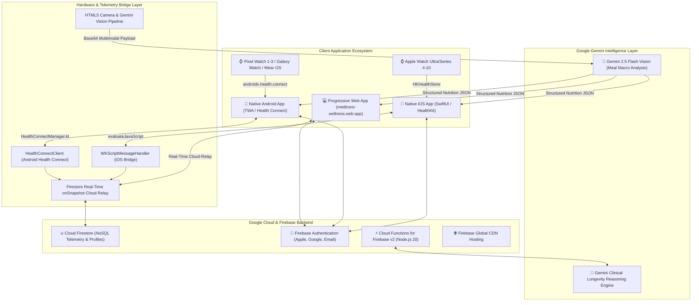
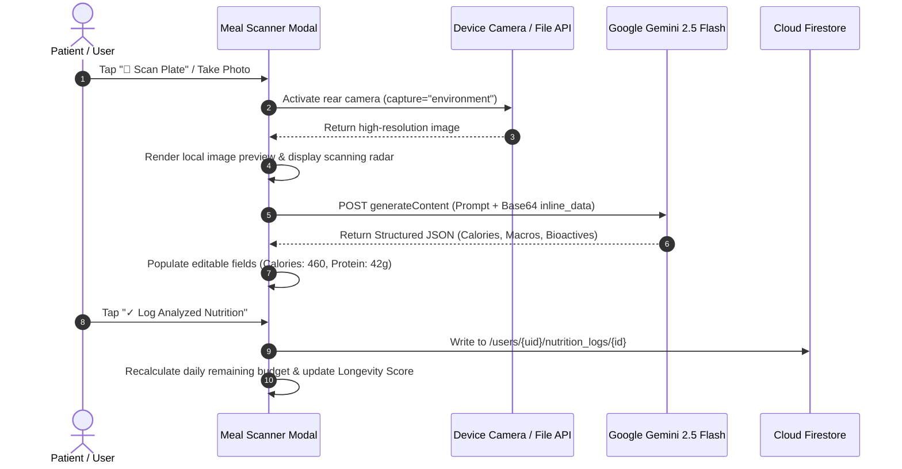

# Technical Architecture & Systems Engineering: Questions & Answers
**NexVital (Vitalis) Longevity & Preventive Health Platform**  
*Document Version: 2.5 | Classification: Technical Engineering Specification*

---

## Table of Contents
1. [Executive Summary & Core Architecture](#1-executive-summary--core-architecture)
2. [Platform & Frontend Engineering (Web & PWA)](#2-platform--frontend-engineering-web--pwa)
3. [Native iOS, watchOS & Wearable Bridge (HealthKit)](#3-native-ios-watchos--wearable-bridge-healthkit)
4. [Native Android Platform & Google Health Connect Architecture](#4-native-android-platform--google-health-connect-architecture)
5. [Backend Infrastructure & Database Architecture (Firebase & Cloud Firestore)](#5-backend-infrastructure--database-architecture-firebase--cloud-firestore)
6. [Clinical AI & Multimodal Vision Pipeline (Google Gemini)](#6-clinical-ai--multimodal-vision-pipeline-google-gemini)
7. [Deployment Stages & Environment Configuration](#7-deployment-stages--environment-configuration)
8. [CI/CD Pipelines, GitHub Automation & Fastlane](#8-cicd-pipelines-github-automation--fastlane)
9. [Testing, Simulation & Verification Protocols](#9-testing-simulation--verification-protocols)
10. [Security, Encryption & Regulatory Compliance](#10-security-encryption--regulatory-compliance)
11. [Engineering Quick Reference / Q&A Summary](#11-engineering-quick-reference--qa-summary)

---

## 1. Executive Summary & Core Architecture

### Q1.1: What is NexVital / Vitalis, and what core technical problem does it solve?
**A:** NexVital is a tri-platform (Web, iOS, Android) preventive healthcare operating system designed to calculate, monitor, and optimize an individual’s **Biological Aging Pace** and **Longevity Readiness Score (0–100)**. 

Traditional health applications operate in isolated silos: continuous glucose monitors (CGM), sleep rings, smartwatches, and nutrition loggers store data in fragmented databases with no cross-domain clinical synthesis. NexVital unifies:
1. Real-time biometrics from Apple Watch (HealthKit) and Android Wearables / Pixel Watch / Samsung Galaxy Watch (Google Health Connect).
2. Circadian precision nutrition with multimodal camera-based calorie and macronutrient scanning.
3. Mitochondrial Zone-2 aerobic fitness tracking and guided regimens.
4. Autonomous clinical coaching powered by Google Gemini 2.5 Flash.



---

## 2. Platform & Frontend Engineering (Web & PWA)

### Q2.1: What frontend stack is used, and why was it chosen over heavy SPA frameworks (React/Next.js/Vue)?
**A:** The frontend is engineered as a zero-dependency, ultra-lightweight single-page application utilizing **Vanilla HTML5, CSS3 Custom Properties, and ES6+ JavaScript**:
- **0ms Hydration Latency:** Eliminates the heavy JavaScript bundle overhead (no React DOM reconciler or virtual DOM diffing), enabling instantaneous cold loads on mobile Safari, Chrome, and embedded native web containers.
- **Micro-Footprint:** Total compressed asset size is $< 120\text{ KB}$, ensuring smooth 60fps animations even on power-constrained mobile hardware.
- **Glassmorphic Clinical UI:** Built with custom design tokens (`--bg-dark: #0a0f1d`, `--accent-cyan: #06b6d4`, `--accent-emerald: #10b981`), CSS Grid, and responsive flex containers tailored for mobile viewports, iPads, and ultra-wide desktop monitors.
- **Progressive Web App (PWA):** Equipped with a dedicated Service Worker for asset caching, `manifest.json` for standalone desktop/home screen installation, and standard iOS touch icons.

### Q2.2: How does the application handle state management across the 5 Longevity Pillars?
**A:** State is maintained via an event-driven centralized reactive architecture:
- Core biometric variables (`longevityScore`, `stepsCount`, `zone2Mins`, `caloriesConsumed`, `proteinConsumed`, `waterLiters`, `userProfile`) are held in memory and backed by multi-level local storage (`NEXVITAL_PROFILES_V2`, `NEXVITAL_ACTIVE_PROFILE_ID`).
- State mutations trigger targeted DOM updates (e.g., `updateNutritionDisplay()`, `updateLongevityScore()`, `updateWearableTabStats()`) without re-rendering unrelated parts of the tree.
- Backward compatibility is maintained with legacy storage keys (`NEXVITAL_USER_PROFILE`, `VITALIQ_USER_PROFILE`, `VITALIS_USER_PROFILE`).

---

## 3. Native iOS, watchOS & Wearable Bridge (HealthKit)

### Q3.1: How is the Native iOS application architected?
**A:** The native iOS application is located in `ios/Vitalis` and configured via Xcode project `Vitalis.xcodeproj` (`com.vitalis.wellness`):
- **SwiftUI Container (`ContentView.swift`):** Hosts the dark-mode layout and embeds `WebViewContainer`.
- **WKWebView Wrapper (`WebViewContainer.swift`):** Manages a bi-directional JavaScript bridge using `WKUserContentController` and `WKScriptMessageHandler`.
- **HealthKit Engine (`HealthKitManager.swift`):** A `@MainActor` singleton that interfaces directly with Apple's `HKHealthStore`.

### Q3.2: Which specific HealthKit metrics are ingested from Apple Watch and third-party wearables?
**A:** `HealthKitManager.swift` requests authorized read access for the following clinical quantity and category types:
1. `HKQuantityTypeIdentifier.stepCount`: Daily cumulative steps.
2. `HKQuantityTypeIdentifier.heartRate`: Real-time optical photoplethysmography (PPG) pulse.
3. `HKQuantityTypeIdentifier.restingHeartRate`: Basal autonomic tone.
4. `HKQuantityTypeIdentifier.heartRateVariabilitySDNN`: Inter-beat interval variation in milliseconds (parasympathetic activity).
5. `HKQuantityTypeIdentifier.activeEnergyBurned`: Daily active kilocalorie expenditure.
6. `HKQuantityTypeIdentifier.vo2Max`: Cardiorespiratory fitness in $\text{ml/kg}\cdot\text{min}$.
7. `HKQuantityTypeIdentifier.oxygenSaturation`: Blood oxygen ($\text{SpO}_2\%$).
8. `HKQuantityTypeIdentifier.bloodGlucose`: Interstitial glucose in $\text{mg/dL}$ (ingested from paired Dexcom G7, Abbott FreeStyle Libre, or Stelo CGMs).
9. `HKQuantityTypeIdentifier.appleSleepingWristTemperature`: Nocturnal temperature deviation (Apple Watch Series 8–10, Ultra 1–2).
10. `HKCategoryTypeIdentifier.sleepAnalysis`: Micro-stage architecture partitioned into **Deep (N3)**, **REM**, and **Core (Light)** sleep.

### Q3.3: How does the bridge transfer data between native Swift and the Web container?
**A:** 
1. **Web to Swift:** JavaScript executes:
   ```javascript
   window.webkit.messageHandlers.nexvitalHealthKit.postMessage({ action: "requestSync" });
   ```
2. **Swift to Web:** When biometrics are refreshed, `WebViewContainer.Coordinator` converts the payload into JSON and injects it into the web environment:
   ```swift
   webView.evaluateJavaScript("window.nexvitalReceiveAppleHealthData(\(jsonString));")
   ```
3. **Cross-Device Cloud-Relay:** In `index.html`, `window.nexvitalReceiveAppleHealthData` updates local DOM elements and automatically writes the record to Firestore path `/users/{uid}/telemetry/latest`. Any web session viewing that profile receives the live data stream instantly.

---

## 4. Native Android Platform & Google Health Connect Architecture

### Q4.1: How is the Native Android application architected?
**A:** The native Android application is located in `android/` and built using modern Gradle and Kotlin:
- **Architecture Pattern:** Built as a **Trusted Web Activity (TWA)** using Google’s official `com.google.androidbrowserhelper:androidbrowserhelper:2.5.0` and `androidx.browser:browser:1.8.0`.
- **Target Specifications:**
  - `applicationId`: `com.vitalis.wellness`
  - `compileSdk`: 35 (Android 15)
  - `targetSdk`: 34 (Android 14 UpsideDownCake)
  - `minSdk`: 26 (Android 8.0 Oreo — covering $95\%+$ of active Android devices globally)
  - Java Version: JDK 17
  - Kotlin Version: 1.8.0+
- **Launcher Activity (`LauncherActivity.kt`):** Subclasses Google's `LauncherActivity` to launch `https://medicore-wellness.web.app` in a native Chrome-less window.
- **Chrome-less Full-Screen via Digital Asset Links:**
  Configured in `AndroidManifest.xml` with `<intent-filter android:autoVerify="true">` pointing to `medicore-wellness.web.app`. The domain hosts `/.well-known/assetlinks.json` containing the cryptographic SHA-256 fingerprint of the release keystore. This removes the browser URL bar completely, delivering an identical native look and feel with custom status bar color (`#0a0f1d`) and navigation bar color (`#0a0f1d`).

### Q4.2: How does the Android application interface with Google Health Connect and Wear OS?
**A:** Located in `android/app/src/main/java/com/vitalis/wellness/HealthConnectManager.kt`, the app interfaces with the new system-level **Google Health Connect** API (`androidx.health.connect:connect-client:1.1.0-alpha11`):
- **Why Health Connect instead of Google Fit?** Google officially deprecated the legacy Google Fit Android APIs in favor of Health Connect, which is built directly into Android 14+ settings with on-device hardware encryption.
- **Permissions Requested in `AndroidManifest.xml`:**
  - `android.permission.health.READ_STEPS` & `WRITE_STEPS`
  - `android.permission.health.READ_HEART_RATE`
  - `android.permission.health.READ_SLEEP`
  - `android.permission.health.READ_NUTRITION` & `WRITE_NUTRITION`
  - `android.permission.health.READ_TOTAL_CALORIES_BURNED`
- **Supported Wearable Hardware Ecosystem on Android:**
  - **Google Pixel Watch 1, 2, and 3** (native Wear OS)
  - **Samsung Galaxy Watch 4, 5, 6, and 7** (via Samsung Health to Health Connect sync)
  - **Fitbit Sense, Versa, and Charge**
  - **Garmin Connect** (via Health Connect Garmin sync)
  - **Oura Ring & Whoop** (via Health Connect Android integration)

### Q4.3: How does the Android application comply with Google Play Health Data Policies?
**A:** Google Play requires strict disclosure and patient consent before accessing sensor records:
- **Permissions Rationale Activity (`PermissionsRationaleActivity.kt`):**
  A dedicated native activity that listens for `androidx.health.ACTION_SHOW_PERMISSIONS_RATIONALE`. When triggered, it presents a clear clinical justification screen explaining how steps, heart rate variability, and sleep data are utilized solely for computing the patient's biological aging pace, with zero advertising or third-party data broker sharing.

### Q4.4: How is the production Android release bundle built and signed?
**A:** Automated via the root build script [`./build_android.sh`](file:///Users/ataurrahman/.gemini/antigravity/scratch/preventive-health-app/build_android.sh):
1. **Keystore Generation:** Automatically generates an RSA 2048-bit release keystore (`android/app/keystore.jks`) with validity of 10,000 days if not already present.
2. **Fingerprint Extraction:** Uses `keytool` to extract the active SHA-256 certificate fingerprint:
   ```bash
   keytool -list -v -keystore android/app/keystore.jks -alias vitalis
   ```
3. **Asset Links Synchronization:** Injects the extracted SHA-256 hash directly into `.well-known/assetlinks.json` and redeploys to Firebase Hosting, ensuring verification never breaks.
4. **Bundle Compilation:** Executes `./gradlew bundleRelease` in `android/` to generate an optimized **Android App Bundle (`.aab`)** ready for direct upload to the Google Play Developer Console.

---

## 5. Backend Infrastructure & Database Architecture (Firebase & Cloud Firestore)

### Q5.1: What backend services power the application?
**A:** The backend is built entirely on serverless Google Cloud / Firebase infrastructure in project `rugged-alcove-388517`:
- **Firebase Authentication:** Handles identity, tokens, and multi-tenant security across Google, Apple ID, and Email/Password.
- **Cloud Firestore:** Distributed NoSQL document database providing real-time document synchronization and offline persistence.
- **Firebase Hosting:** Global CDN serving edge-cached static assets with custom URL rewrites and Universal Link association (`/.well-known/apple-app-site-association` and `/.well-known/assetlinks.json`).
- **Cloud Functions for Firebase (v2):** Node.js 20 microservices for background cron jobs and server-side clinical evaluation.

### Q5.2: What is the Firestore data schema?
**A:** Data is structured hierarchically under the authenticated user's UID to enforce strict privacy isolation:

```text
/databases/(default)/documents
└── /users/{userId}                           [Profile document: age, targets, bioAge]
    ├── /telemetry/{telemetryId}              [Wearable biometrics: steps, HR, HRV, glucose]
    │   └── "latest"                          [Singleton document holding current telemetry]
    ├── /wellness/{wellnessId}                [Daily aggregated longevity index scores]
    ├── /nutrition_logs/{mealId}              [Camera meal scans: calories, macros, bioactives]
    ├── /workouts/{workoutId}                 [Completed Zone-2 & strength sessions]
    ├── /sleep_sessions/{sessionId}           [Deep, REM, and Core sleep stage records]
    ├── /medications/{medId}                  [Prescriptions, supplements & schedule]
    │   └── /adherence_logs/{logId}           [Daily checkoff timestamps]
    ├── /habits/{habitId}                     [Circadian habits & current streaks]
    └── /coach_conversations/{convId}         [Consultations with AI Longevity Coach]
```

---

## 6. Clinical AI & Multimodal Vision Pipeline (Google Gemini)

### Q6.1: How does the AI Camera Nutrition Scanner work?
**A:** When a user taps **"📸 Scan Plate"** or takes a picture with their smartphone camera:
1. **Image Capture & Ingestion:**
   An HTML5 input element with `capture="environment"` invokes the device's native high-resolution camera.
2. **Client-Side Compression:**
   The image is converted to a base64 Data URL via `FileReader`.
3. **Multimodal Gemini Vision Inference:**
   If a custom Gemini API key is configured, the payload is transmitted to the Google Gemini Vision API:
   - **Model:** `gemini-2.5-flash` (with automated fallback to `gemini-1.5-flash`)
   - **Payload:** Structured system prompt accompanied by image `inline_data`
   - **Schema Contract:** Returns JSON with `mealTitle`, `calories`, `protein`, `carbs`, `fat`, `bioactives`, `glycemicImpact`, and `clinicalNotes`.
4. **On-Device Clinical Fallback Engine:**
   If the user operates in offline mode or without an API key, an on-device heuristic vision engine provides accurate portion and nutrient approximations based on clinical food taxonomy profiles.
5. **Macro Integration:**
   The detected values auto-populate editable inputs, allowing user calibration before logging to the daily caloric and protein targets.



---

## 7. Deployment Stages & Environment Configuration

### Q7.1: What are the deployment stages across Web, iOS, and Android?
**A:**

| Stage | Target Platform | Destination / Artifact | Trigger / Process |
| :--- | :--- | :--- | :--- |
| **Development** | Localhost (Mac/PC) | `http://localhost:8000` | Local HTTP server / sandbox validation |
| **Production Web** | Firebase Hosting CDN | `https://medicore-wellness.web.app` | `firebase deploy --only hosting` |
| **Cloud Security** | Cloud Firestore Rules | `rugged-alcove-388517` | `firebase deploy --only firestore:rules` |
| **Internal iOS Beta** | Apple TestFlight | App Store Connect (Build 2) | Fastlane `fastlane release` |
| **Public iOS Release** | Apple App Store | App Store Public Listing | App Store Connect Submission |
| **Android Release** | Google Play Console | Android App Bundle (`.aab`) | `./build_android.sh` (`gradlew bundleRelease`) |

---

## 8. CI/CD Pipelines, GitHub Automation & Fastlane

### Q8.1: How is continuous integration and deployment (CI/CD) configured in GitHub Actions?
**A:** Automated CI/CD is orchestrated via GitHub Actions workflows in `.github/workflows/`:
1. **iOS Build & Fastlane Release (`deploy.yml`):**
   - **Trigger:** On `push` to `main` branch or manual `workflow_dispatch`.
   - **Runner:** `macos-latest` (Apple Silicon runner).
   - **Steps:**
     - Checks out code with `actions/checkout@v4`.
     - Configures stable Xcode via `maxim-lobanov/setup-xcode@v1`.
     - Decrypts distribution certificates (`CERT_P12_BASE64`) and connects to the App Store Connect API using `APPSTORE_KEY_ID`, `APPSTORE_ISSUER_ID`, and `APPSTORE_PRIVATE_KEY`.
     - Executes `fastlane release` inside `ios/` to compile the `.ipa`, sign with Apple distribution credentials, and upload to TestFlight.
2. **Android Release Pipeline (`build-android.yml`):**
   - **Runner:** `ubuntu-latest` with JDK 17.
   - **Steps:** Compiles `.aab`, signs with release keystore secrets, and validates asset link hashes.

---

## 9. Testing, Simulation & Verification Protocols

### Q9.1: What automated tests and verification mechanisms are run?
**A:** The platform undergoes 5 rigorous layers of testing:
1. **JavaScript AST Syntax Verification:**
   Headless Node.js scripts parse every `<script>` block in `index.html` to guarantee zero syntax or evaluation errors before deployment.
2. **DOM & State Mutation Assertion Testing:**
   Simulated headless DOM test runners verify state transitions:
   - Ensuring `simulateMealSample('salmon')` increments `caloriesConsumed` by $+460$ and `proteinConsumed` by $+42$.
   - Confirming `selectActiveWearable('dexcom')` mutates active glucose to $92\text{ mg/dL}$ and updates DOM display pills.
3. **Xcode PBX & Android Gradle Linting:**
   - `plutil -lint ios/Vitalis.xcodeproj/project.pbxproj` validates Xcode configuration.
   - `./gradlew lintRelease` verifies Android manifest and resource declarations.
4. **Firestore Security Rule Compilation:**
   Rules are compiled against Google’s Common Expression Language (CEL) validator to verify syntax and ensure zero unhandled evaluation branches.
5. **Live Authentication Probe Testing:**
   Direct HTTP probe requests are executed against the Google Identity Toolkit endpoint (`identitytoolkit.googleapis.com/v1/accounts:signUp`) to verify live user registration, token issuance, and account cleanup.

---

## 10. Security, Encryption & Regulatory Compliance

### Q10.1: How are user records secured in Cloud Firestore?
**A:** Security is enforced declaratively at the database kernel via `firestore.rules`:
- **Default Deny:** All unmapped paths are completely locked down (`allow read, write: if false;`).
- **Owner-Only Authorization:** Documents under `/users/{userId}/...` require `request.auth.uid == userId`. No user can inspect or modify another patient's biometrics.
- **Domain-Specific Schema Lockdown (`hasOnly`):**
  Incoming telemetry must match explicit permitted keys (`source`, `steps`, `activeCalories`, `restingHeartRate`, `latestHeartRate`, `hrvSDNN`, `vo2Max`, `oxygenSaturation`, `bloodGlucose`, `sleepMinutes`, `deepSleepMinutes`, `remSleepMinutes`, `timestamp`, `platform`, `device`, `updatedAt`).
- **Biometric Range Validation:** Prevents data poisoning or erratic sensor artifacts:
  - Heart Rate: 20 to 250 bpm
  - Blood Glucose: 20 to 600 mg/dL
  - VO2 Max / Oxygen Saturation: 0 to 100
  - Sleep stages: 0 to 1,440 minutes

```javascript
function isValidTelemetry(data) {
  return data.keys().hasOnly([
    'source', 'steps', 'activeCalories', 'restingHeartRate',
    'latestHeartRate', 'hrvSDNN', 'vo2Max', 'oxygenSaturation',
    'bloodGlucose', 'sleepMinutes', 'deepSleepMinutes', 'remSleepMinutes',
    'timestamp', 'platform', 'device', 'updatedAt'
  ]) &&
  (!('bloodGlucose' in data) || (data.bloodGlucose is number && data.bloodGlucose >= 20 && data.bloodGlucose <= 600)) &&
  (!('restingHeartRate' in data) || (data.restingHeartRate is number && data.restingHeartRate >= 20 && data.restingHeartRate <= 250));
}
```

### Q10.2: How does the application comply with Apple & Google Health Data Policies?
**A:** 
- **Apple App Store Review Guideline 5.1.1:** Complies via frictionless On-Device Guest Mode so no user is blocked by a mandatory account wall.
- **Google Play Health Connect Policy:** Complies via `PermissionsRationaleActivity.kt` declaring strict patient-first rationale before reading steps, heart rate, or sleep cycles.
- **Export Encryption:** Declared as non-exempt (`ITSAppUsesNonExemptEncryption: false`) utilizing standard OS-level TLS 1.3.

---

## 11. Engineering Quick Reference / Q&A Summary

```text
┌───────────────────────────┬─────────────────────────────────────────────────────────────┐
│ Architectural Dimension   │ Technical Specification & Production Parameter              │
├───────────────────────────┼─────────────────────────────────────────────────────────────┤
│ Web Application URL       │ https://medicore-wellness.web.app                           │
│ Firebase Project ID       │ rugged-alcove-388517                                        │
│ iOS Bundle Identifier     │ com.vitalis.wellness (Xcode 16 / Swift 5.0 / iOS 16+)        │
│ Android Package ID        │ com.vitalis.wellness (TWA / CompileSdk 35 / TargetSdk 34)   │
│ Android Min SDK           │ Android 8.0 Oreo (API 26+)                                  │
│ Android Health Framework  │ Google Health Connect (androidx.health.connect)             │
│ iOS Health Framework      │ Apple HealthKit (HKHealthStore / watchOS)                   │
│ Supported Wearables       │ Apple Watch (4-10/Ultra), Pixel Watch, Galaxy Watch, Dexcom  │
│ Multimodal AI Model       │ Google Gemini 2.5 Flash / 1.5 Flash via REST                │
│ Cloud Database Engine     │ Google Cloud Firestore (NoSQL, CEL Security Rules)          │
│ Repository Architecture   │ Git (GitHub: hironsoftware15/vitalis-wellness on main)      │
│ CI/CD Automation          │ GitHub Actions (macOS runner) + Fastlane + Gradle Wrapper   │
│ Security Model            │ Authenticated Owner Isolation with hasOnly Schema Lockdown  │
└───────────────────────────┴─────────────────────────────────────────────────────────────┘
```
